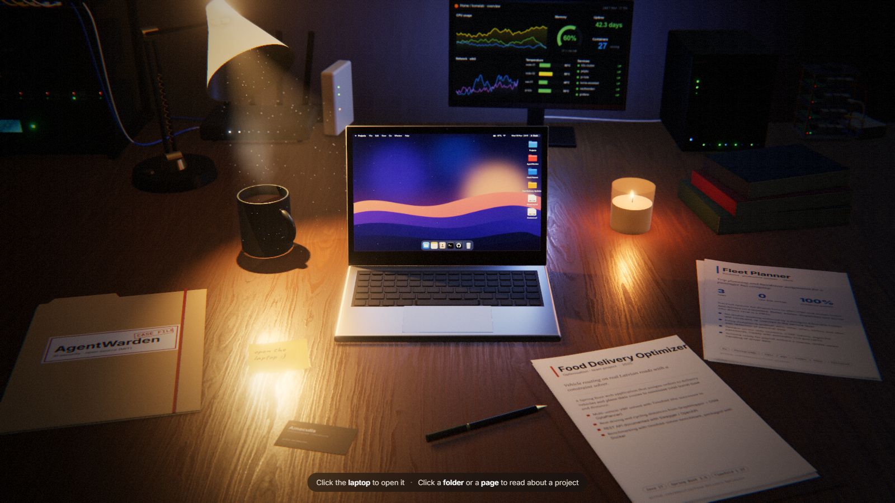

# Amaculis — interactive CV

**Software engineer · Cybersecurity · Riga, Latvia**
MSc Cybersecurity, Riga Technical University

**👉 [Open the CV](https://amaculis.github.io/cv-amaculis/)**

Instead of a PDF, my CV is a desk at night. A lamp, a candle, a laptop, a few papers, and a small homelab against the wall: the kind of place where I actually work on my projects. Everything is real 3D in the browser and nothing needs installing.



## How to look around

- **Click the laptop.** The camera flies into the screen and opens a small "Portfolio OS" with all projects, an About page and a terminal.
- **Click the folder or a printed page** on the desk to pick it up and read about a project.
- **Click the mug or the business card** for About and contact.
- **Blow out the candle or switch off the lamp** and see who comes to light them again.
- Move the mouse to look around a little; scroll to zoom. Works on phones too.

Short on time? Everything below is also inside the laptop.

## What I build

I like systems that have to be correct and secure by default: guardrails for AI agents, decentralised identity, audit-grade backends and optimisation problems.

### 🛡 [AgentWarden](https://github.com/Amaculis/AgentWarden) · AI security, open source
A semantic firewall between an AI coding agent and your machine. It intercepts every action and decides allow, deny or ask from what the action *means* in the context of the task. A cascade of rules, a local Llama 3.1 8B judge and a large model for hard cases keeps 87.5 % of decisions on the machine.
**0 of 147 red-team attacks got through**, at about 40× lower cost than sending every action to the large model. Fails closed on any error.

### 🚌 [Fleet Planner](https://github.com/Amaculis/fleet-planner) · Go backend
Trip planning and bus/driver assignment for a passenger bus company, with admin, dispatcher and driver roles. Double-booking is made impossible by a Postgres exclusion constraint, every mutation is audited, sessions are server-side with CSRF protection and argon2id, and all SQL is compile-checked through sqlc.
*Go · PostgreSQL · sqlc · templ/htmx · Caddy · Docker*

### 🪪 [DID Offline Revocation](https://github.com/Amaculis/DID-offline-revocation-gossips-solution) · Master's thesis research
How quickly does a revoked credential stop working when verifiers are often offline? A discrete-event simulator (up to 1,000,000 nodes) compares PULL, PUSH, gossip and a hybrid where credential holders carry fresh revocation lists between verifiers. The hybrid keeps false acceptance near zero almost everywhere, at the cost of the most bandwidth.
*Python · SimPy · NetworkX · pandas*

### 💊 [Pharma Integrity Ledger](https://github.com/Amaculis/Blockchain-based-pharmaceutical-processing-integrity-verification-system) · Blockchain, team project
Tamper-proof audit trail for pharmaceutical manufacturing: sensitive data stays in each company's database, only hashes and timestamps go on-chain, and an auditor re-hashes the records to verify them. Team of four; my part was the blockchain layer (Solidity contract, Hardhat in Docker, the link to the .NET API).
*Solidity · Hardhat · C# / .NET · PostgreSQL · Docker*

### 🚴 [Food Delivery Optimizer](https://github.com/Amaculis/Food-Delivery-Optimizer) · Optimisation, team project
Vehicle routing on real Latvian roads: Timefold Solver for the routing problem, GraphHopper and OpenStreetMap for real distances, an interactive Leaflet map.
*Java · Spring Boot · Timefold · GraphHopper*

### 🧭 [VRP with Simulated Annealing](https://github.com/Amaculis/1mpd_am21169) · Coursework
Fuel-limited vehicle routing solved with a hand-written metaheuristic: five neighbourhood moves, Metropolis acceptance and geometric cooling.
*Python · matplotlib*

## Skills

| | |
|---|---|
| **Languages** | Python, Go, Java, TypeScript, C#, Solidity, SQL |
| **Security** | Prompt-injection defence, fail-closed design, auth & sessions, GDPR-aware data models, SSI / DID |
| **Backend** | PostgreSQL, Spring Boot, Node.js, REST / OpenAPI, Docker, Caddy |
| **AI & optimisation** | Local LLMs (Llama), LLM-as-judge, Timefold Solver, simulated annealing, discrete-event simulation |

## About this site

It is itself a small project: TypeScript, Three.js and Vite, published on GitHub Pages. Almost everything on the desk (laptop, lamp, candle, the homelab with its blinking LEDs and a live-looking dashboard) is built in code; lighting is real-time with depth of field, bloom and ambient occlusion. It uses WebGL, so it needs a reasonably modern browser.

## Contact

GitHub: [@Amaculis](https://github.com/Amaculis)

---

<details>
<summary>Run it locally</summary>

```bash
npm install
npm run dev      # http://localhost:5173
npm run build    # → dist/
```

Content lives in [`src/data.ts`](src/data.ts). Pushing to `main` deploys to GitHub Pages through `.github/workflows/deploy.yml` (Settings → Pages → Source: GitHub Actions).

</details>

<sub>Credits: wood texture (`oak_veneer_01`) and HDRI (`brown_photostudio_02`) from [Poly Haven](https://polyhaven.com), CC0. Hand model (`public/models/hand-right.glb`): the `generic-hand` profile from [webxr-input-profiles](https://github.com/immersive-web/webxr-input-profiles), MIT.</sub>
